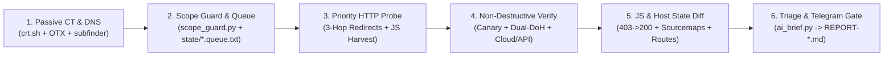

<div align="center">


**Stateful Bug Bounty Reconnaissance, Non-Destructive Exposure Verification, JS Bundle Diffing, and Report Drafting Engine for GitHub Actions**

[](https://www.python.org/)
[](./.github/workflows/nova.yml)
[](./scripts/ai_brief.py)
[](./tests/test_nova.py)
[](./LICENSE)

</div>

---

## Overview

`Nova-Recon` monitors authorized bug bounty scopes for newly issued certificates, newly deployed subdomains, and modified JavaScript bundles. Instead of running noisy template scans across static targets, `Nova-Recon` persists per-program asset memory inside [`state/`](./state), queues unprobed hosts across runs, verifies exposures through deterministic canary checks, and sends ready-to-review Markdown reports (`REPORT-<program>-<type>-<hash>.md`) to Telegram only when a finding passes both deterministic and LLM verification gates.

### Core Modules & Verification Gates

1. [`scripts/scope_guard.py`](./scripts/scope_guard.py) parses `targets/<program>.txt` into a `ProgramPolicy` supporting root domains, explicit single-host targets, wildcard includes (`*.example.com`), exact or wildcard exclusions (`!sso.example.com`, `!*.internal.example.com`), and regex exclusions (`!regex:^dev-sandbox-\d+\.`). Every discovered hostname, redirect destination, and extracted JavaScript endpoint is checked against this policy before any network request leaves the runner.
2. [`scripts/nova.py`](./scripts/nova.py) (`monitor`) queries Certificate Transparency and passive DNS sources (`crt.sh`, `subdomain.center`, `AlienVault OTX`) and merges optional `subfinder` output. It compares results against `state/<program>.subs.txt`, seeds legacy unprobed inventories (`NOVA_SEED_CAP=1000`), and persists overflow hosts in `state/<program>.queue.txt` so rate-capped runs (`NOVA_MAX_NEW_PROBE=250`) never drop discovered subdomains.
3. [`scripts/nova.py`](./scripts/nova.py) (`probe`) prioritizes subdomains whose prefix matches development, staging, API, admin, or internal naming patterns (`_subdomain_prefix`). It follows up to 3 same-host HTTP redirects (`301`, `302`, `303`, `307`, `308`) while stopping at authentication walls (`/login`, `/signin`, `/sso`, `/oauth`), then extracts `<script src>` and `<link rel="modulepreload" href="...js">` asset URLs.
4. [`scripts/nova.py`](./scripts/nova.py) (`verify` & `diff`) and [`scripts/js_intel.py`](./scripts/js_intel.py) verify sensitive file exposures, claimable subdomain takeovers via dual DNS-over-HTTPS resolvers, credentialed CORS reflections, GraphQL introspection schemas, high-entropy secrets in JS bundles and `.js.map` sourcemaps, unauthenticated JSON API routes, and unclaimed or publicly listable AWS S3 and Firebase Realtime Database assets. JavaScript bundle hashes (`sha256`) are deduplicated across subdomains so shared CDN assets are analyzed once per program.
5. [`scripts/ai_brief.py`](./scripts/ai_brief.py) filters out common false positives (informational `dangling-cname` records, uncredentialed wildcard CORS, HTML/WAF catch-all pages, and unverified JS route lists) in `deterministic_fp_check()`, validates raw HTTP or DNS evidence through Groq (`llama-3.3-70b-versatile` in JSON mode), and renders verified findings into standalone Markdown attachments (`REPORT-<program>-<type>-<hash>.md`).
6. [`scripts/browser_harvest.py`](./scripts/browser_harvest.py) drives `playwright-cli` in headless Chromium during local workflows to capture dynamically loaded webpack/Vite JS chunks and sourcemap URLs from client-rendered applications.

---

## Pipeline Architecture



### Verification Matrix

| Check Type | Verification Mechanism | False-Positive Guard | Default Severity |
| :--- | :--- | :--- | :--- |
| `exposure` | Probes `/.env*`, `/.git/config`, `/.git/HEAD`, `/actuator/env`, `/actuator/heapdump`, `/debug/vars`, `/server-status` | Requires real secret/header signatures + requests a random sibling canary URL to reject catch-all `200 OK` routers | `high` / `critical` |
| `takeover` | Matches CNAME targets against 14 claimable cloud provider fingerprints | Confirms dead DNS status or provider unclaimed body banner across both Cloudflare (`1.1.1.1`) and Google (`8.8.8.8`) DoH | `high` |
| `cloud-takeover` / `cloud-exposure` | Extracts AWS S3 and Firebase URLs from JS bundles and tests bucket root or `/.json?shallow=true` | Requires `<Code>NoSuchBucket</Code>`, `<ListBucketResult>` with `<Contents>`, or non-error JSON payload | `high` |
| `unauth-api` | Politely requests concrete API routes extracted from JS diffs with `Accept: application/json` | Drops `401/403/404`, HTML responses, and error payloads; requires sensitive JSON keys + sibling canary check | `high` |
| `js-secret` | Scans first-party JS bundles and `.js.map` (`sourcesContent`) for 16 credential formats | Enforces Shannon entropy thresholds (`_has_real_entropy`), skips vendor libraries, and rejects placeholder strings | `high` |
| `cors` | Sends an external `Origin` header to live hosts | Requires exact origin reflection paired with `Access-Control-Allow-Credentials: true` | `high` |
| `graphql` | Sends a minimal `__schema` query to `/graphql` and `/api/graphql` | Requires valid JSON schema output and extracts sensitive query/mutation names | `medium` |

---

## Quickstart (Local CLI)

### Prerequisites

- Python 3.10+ with `requests` (`pip install requests`)
- [`subfinder`](https://github.com/projectdiscovery/subfinder) on `PATH` (optional, used for expanded passive subdomain enumeration)
- `playwright-cli` on `PATH` (optional, used by `scripts/browser_harvest.py` for local headless SPA chunk harvesting)

### 1. Clone & Run the Test Suite

```bash
git clone https://github.com/JosuaZxz/Nova-Recon.git
cd Nova-Recon
pip install requests

# Run the 14 unit tests covering scope_guard, js_intel, ai_brief, and nova pipeline gates
python -m unittest discover -s tests -v
```

### 2. Audit Target Scope Files

```bash
python scripts/nova.py scope
```

### 3. Run the Full Pipeline on Selected Programs

```bash
# Run monitor -> probe -> verify -> diff -> brief on specific programs
python scripts/nova.py run --programs boozt,bykea

# Run across the 20 curated programs in targets/_focus.txt and send validated reports to Telegram
export GROQ_API_KEY="your_groq_api_key"
export TELEGRAM_TOKEN="your_telegram_bot_token"
export TELEGRAM_GENERAL_ID="your_telegram_chat_id"
python scripts/nova.py run --send-telegram
```

### 4. Run Individual Pipeline Stages

```bash
# Stage 1: Passive discovery + scope filter + queue update
python scripts/nova.py monitor --program remitly

# Stage 2: Polite HTTP probing + same-host redirect following + JS URL extraction
python scripts/nova.py probe --program remitly

# Stage 3: Verify exposures, takeovers, CORS, GraphQL, JS secrets, and cloud buckets
python scripts/nova.py verify --program remitly

# Stage 4: Check previously tracked hosts for status transitions (403/404 -> 200) and JS bundle diffs
python scripts/nova.py diff --program remitly --budget 60

# Stage 5: Build daily Markdown briefing and deliver REPORT-*.md attachments
python scripts/nova.py brief --send-telegram
```

### 5. Harvest Dynamic SPA Chunks (Optional Local Workflow)

```bash
python scripts/browser_harvest.py --url https://app.example.com --out data/spa_js.txt
```

---

## GitHub Actions Automation Setup

The workflow in [`.github/workflows/nova.yml`](./.github/workflows/nova.yml) executes automatically every hour at minute 15 (`15 * * * *`), on pushes to `scripts/**` or `targets/_focus.txt`, or manually via `workflow_dispatch`. Each run executes the unit test suite first, processes a rotating batch of `6` programs from `targets/_focus.txt`, sends verified `REPORT-*.md` files to Telegram, and commits updated asset state back to `state/` with `[skip ci]`.

### 1. Configure Repository Secrets

In your forked repository, navigate to **Settings > Secrets and variables > Actions** and add:

| Secret Name | Required | Description |
| :--- | :--- | :--- |
| `GROQ_API_KEY` | Recommended | Groq API key for `llama-3.3-70b-versatile` evidence validation and Markdown report drafting (falls back to deterministic validator if unset) |
| `TELEGRAM_TOKEN` | Yes (for alerts) | Telegram Bot token from `@BotFather` |
| `TELEGRAM_GENERAL_ID` | Yes (for alerts) | Telegram chat or channel ID for briefing summaries and `REPORT-*.md` document attachments |
| `TELEGRAM_DATA_ID` | Optional | Separate Telegram chat ID for daily `NOVA_VALIDATED_REPORTS_<date>.zip` evidence archives (defaults to `TELEGRAM_GENERAL_ID` if omitted) |
| `INTIGRITI_USERNAME` | Optional | Used when enabling `NOVA_EXTRA_HEADERS` for programs requiring researcher identification headers |

### 2. Tunable Environment Variables

You can customize rate limits and batch budgets in [`.github/workflows/nova.yml`](./.github/workflows/nova.yml) or your local shell:

| Variable | Default (CLI / CI) | Purpose |
| :--- | :--- | :--- |
| `NOVA_MAX_CONC` | `12` / `20` | Maximum concurrent HTTP worker threads |
| `NOVA_REQ_DELAY` | `0.12` / `0.08` | Minimum delay in seconds between requests |
| `NOVA_PER_HOST_CAP` | `10` | Maximum requests allowed against a single hostname per stage |
| `NOVA_MAX_NEW_PROBE` | `250` | Maximum new or queued subdomains probed per program per run |
| `NOVA_SEED_CAP` | `1000` | Maximum unprobed legacy subdomains seeded into `state/<program>.queue.txt` on initial migration |
| `NOVA_MAX_JS` | `120` | Maximum first-party JavaScript bundles fetched per program per run |
| `NOVA_DIFF_BUDGET` | `60` | Number of previously tracked hosts re-checked during the `diff` stage |
| `NOVA_MONITOR_BUDGET` | `240` | Time budget in seconds for passive CT discovery per program |
| `NOVA_EXTRA_HEADERS` | `{}` | JSON object of custom HTTP headers appended to every outbound request (for example `{"X-Bug-Bounty":"hunter"}`) |

---

## Scope Configuration (`targets/`)

Each file in [`targets/<program>.txt`](./targets) defines the authorized scope for one bug bounty program. [`scripts/scope_guard.py`](./scripts/scope_guard.py) supports root domains, explicit subdomains, wildcards, and exclusion rules prefixed with `!`:

```text
# targets/example_program.txt
# 1. Root domains and wildcard includes (subdomains automatically in-scope)
example.com
*.cloud.example.com

# 2. Explicit single-host targets
api-partner.example.net

# 3. Exclusions (always override includes)
!status.example.com
!*.Staging-OutOfScope.example.com
!regex:^dev-internal-\d+\.example\.com$
```

To prioritize specific programs during scheduled rotation, list their file stems (one per line) in [`targets/_focus.txt`](./targets/_focus.txt).

---

## Repository Structure

```text
Nova-Recon/
├── .github/
│   └── workflows/
│       └── nova.yml                 # Hourly GitHub Actions pipeline (unittest -> recon -> brief -> state sync)
├── scripts/
│   ├── nova.py                      # Main CLI driver (scope, monitor, probe, verify, diff, brief, run)
│   ├── scope_guard.py               # Scope policy parser, wildcard/regex exclusion filter, and focus loader
│   ├── js_intel.py                  # JS secret scanner, entropy filter, cloud URL extractor, and bundle differ
│   ├── ai_brief.py                  # Deterministic false-positive filter, Groq LLM validator, and REPORT-*.md generator
│   └── browser_harvest.py           # Optional local playwright-cli headless SPA script and sourcemap harvester
├── targets/
│   ├── _focus.txt                   # Curated list of 20 priority programs for scheduled rotation
│   └── *.txt                        # Per-program in-scope domains and !exclude rules
├── state/
│   ├── <program>.subs.txt           # Persistent discovered subdomain inventory
│   ├── <program>.queue.txt          # Lossless overflow queue of subdomains awaiting HTTP probe
│   ├── <program>.hosts.json         # Live host status, title, redirect chain, and JS URL snapshot
│   └── <program>.js.json            # Canonical JS bundle sha256 hashes, extracted API routes, and GraphQL ops
├── tests/
│   └── test_nova.py                 # 14 unit tests verifying scope rules, JS diffing, canary gates, and queues
├── HANDBOOK.md                      # Operational notes (Indonesian)
├── SCOPE_TODO.md                    # Manual scope verification checklist
└── LICENSE                          # MIT License (JosuaZxz)
```

---

## Responsible Disclosure & Compliance

- Only add domains to `targets/<program>.txt` that are explicitly authorized under an active bug bounty or vulnerability disclosure policy.
- `Nova-Recon` performs passive discovery and read-only HTTP/DNS verification with per-host request caps (`NOVA_PER_HOST_CAP`). It does not send exploitation payloads, fuzzing traffic, or brute-force requests.
- Verified findings and `REPORT-*.md` files are written locally to `findings/` (excluded via [`.gitignore`](./.gitignore)) and delivered to your private Telegram chat. They are never committed to the public repository.
- Always reproduce and confirm every lead manually in an isolated browser session and review the program's rules of engagement before submitting a report.

---

## License

Released under the [MIT License](./LICENSE) by [JosuaZxz](https://github.com/JosuaZxz).
